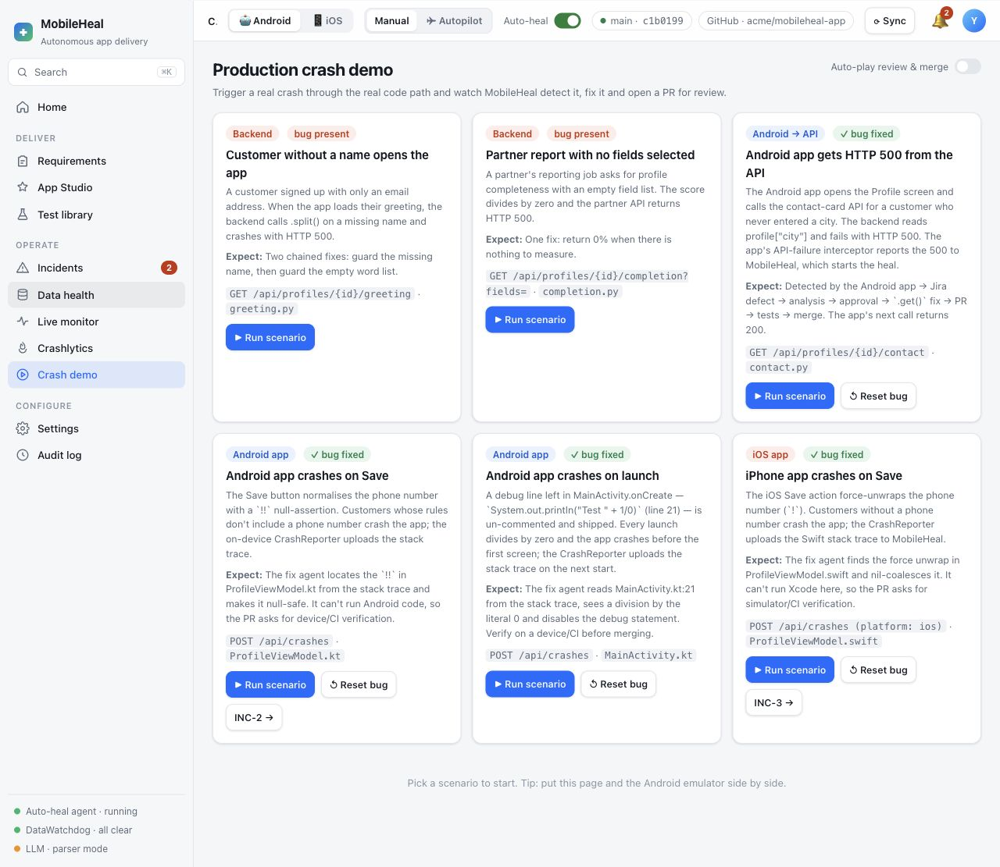

# MobileHeal demo

A runnable MobileHeal application and an illustrated, 14-lesson codelab. Take a requirement through design, generated code, review, interactive tests and a local merge; then explore crash recovery and data health.

## Choose how to run it

Requirements: Python 3.10+ (3.12 recommended) and Git. No API keys are needed.

| Option | What you get | Command | Open |
|---|---|---|---|
| **A · Tutorial only** | The 14-lesson guide in a simple sandbox: read, learn the flow, no servers to set up | `bash run-tutorial.sh` | http://localhost:8080 |
| **B · Tutorial + App + Backend** | The full package: guide, web app and working backend side by side | `bash start.sh` | http://localhost:8080 and http://localhost:8000 |
| **C · App + Backend** | The real app and server, ready for work, no tutorial | `bash run-application.sh` | http://localhost:8000 |

Stop any option with **Ctrl+C**. Change ports with `MOBILEHEAL_PORT=8001 CODELAB_PORT=8081 bash start.sh`.

### Option A — Tutorial only

```bash
bash run-tutorial.sh
```

Serves the codelab only. Good for a first look; links that open the app need Option B or C.

### Option B — Tutorial + App + Backend

```bash
bash start.sh
```

Installs the backend libraries into `backend/.venv` on first run, then starts the app on port 8000 and the guide on port 8080. Follow the guide in one tab and do each step in the app in another.

### Option C — App + Backend

```bash
bash run-application.sh
```

Starts only the web app and backend on port 8000, for day-to-day use and the demos below.

## How it works

<p align="center"></p>

<p align="center"></p>

## Four demos

Short, action-only scripts for each are in [docs/DEMOS.md](./docs/DEMOS.md).

| Demo | Story | Starts at |
|---|---|---|
| 1 · Android crash → auto-fix | `1/0` on line 21 of `MainActivity.kt` crashes the app; the fix is ready to ship | `/#crashes` |
| 2 · Business analyst change request | A plain-English request becomes tested code, ready for production | `/#new` |
| 3 · Pega ticket → production | A support ticket gets a root cause, a Jira ticket (mocked offline) and a fix | `/#incidents` |
| 4 · Error email → safe deploy | An employee's error email is diagnosed, fixed and deployed behind the human switch | `/#incidents` |

<p align="center"></p>

## Product controls

- Agent control center: `/agents` — actual stage records, evidence confidence, reviewer receipts and explicit local human approval.
- Workflow studio: `/workflow-map` — five-source animated sample with pass/rework routing, pause, replay and static view.
- [Agent harness](docs/AGENT-HARNESS.md): durable execution and review contracts.
- [Guardrails](docs/GUARDRAILS.md): evidence scores, mandatory gates and execution limits.
- [Production design](docs/PRODUCTION.md) and [threat model](docs/THREAT-MODEL.md): deployment requirements and remaining boundaries.
- [Five-slide pitch](pitch/output/MobileHeal-final.pptx): editable product and architecture presentation.

## What's inside

- [Complete codelab](codelab/guide.md): setup, delivery, tests and merge, crash recovery, data health, native clients, integrations, troubleshooting and reset.
- [Application reference](docs/APPLICATION.md): the supplied project's detailed technical documentation.
- [Verification record](docs/VERIFICATION.md): actual checks and known limitations.
- `codelab/`: static HTML/CSS/JavaScript, generated lesson data, seven real screenshots, and three animated architecture and workflow diagrams (`codelab/diagrams/`, also in `docs/images/`). No external runtime assets.
- `backend/`, `android/`, `ios/`, `figma-plugin/`: the supplied application source and tests.

The guide has deep-linked lessons, lesson search, local reading progress, code-copy controls and screenshot enlargement. Rebuild lesson data after editing `codelab/guide.md`:

```bash
python3 scripts/build-diagrams.py   # after editing a diagram
python3 scripts/build-guide.py
```

## Tests

From an activated virtual environment:

```bash
cd backend
python -m pytest -q
```

The inherited suite is not assumed green. See the verification record. The release harness executes narrowly defined application-owned checks for supported local journeys. These are distinct from the inherited repository suite and native device verification.

## Native clients

The core lab runs entirely in the browser. Android and iOS require their SDKs and independent build/device verification. Android Firebase configuration is excluded: supply your own `google-services.json` for the build you use. See the codelab's native-client lesson and `ios/README.md`.

## Demo boundaries

Local Git commits and branches are real; external integrations are simulated. Tutorial review approvals use clearly fictional demo roles. No cloud deployment or app-store release occurs. Some supplied bugs are intentional crash-lab material. Credentials, databases, build outputs, generated historical incident records and virtual environments are excluded.

The guide's format is inspired by [Google Codelabs](https://codelabs.developers.google.com/codelabs/agent-valley-buildyard/instructions). Its content, styling and screenshots are original MobileHeal documentation.
