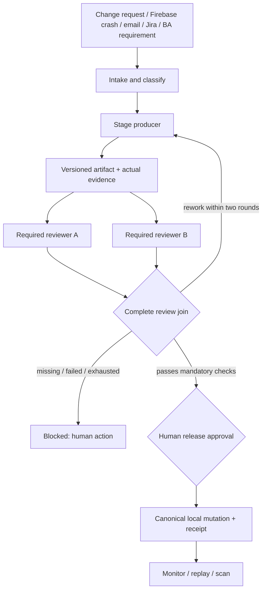

# Agent execution harness

The harness owns the execution graph. A producer proposes artifacts; independent reviewers consume frozen copies of the same evidence. A policy join validates every required reviewer and check. A model cannot invent a routing destination or grant itself approval.

`harness_models.py` defines closed schemas. `harness_policy.py` computes explained evidence confidence with hard blockers. `harness_store.py` persists run/stage/event/mutation records. `harness.py` executes one stage per durable run and joins required reviews. `harness_tools.py` owns named tool permission and execution limits. `harness_redaction.py` sanitizes audit/provider boundaries.

Run input identity binds to a commit; stage identity and attempt are persisted before execution. Workflow items group their stage run IDs. Database revisions reject stale updates. Human approvals bind to the precise snapshot rather than trusting a browser button or producer-authored flag.

Review timeouts discard late output; they do not certify that an in-process reviewer thread has stopped. Mutation receipts distinguish known success from unknown outcome. A failed or interrupted mutation is reconciled before any subsequent execution, never repeated under a new key. Restart reconciliation requires stopped workers.

Read GUARDRAILS.md for exact scoring, budgets and isolation limitations. PRODUCTION.md defines the deployment prerequisites. The animated Workflow studio is a clearly labeled teaching sample; it is separate from actual run records.
