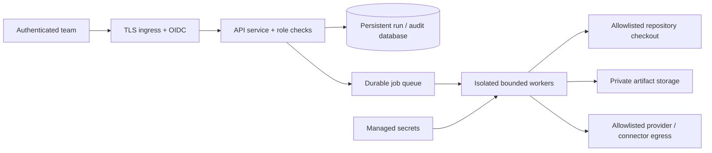

# Production deployment design

Status: deployment design, not a deployed or certified environment. The runnable local product uses loopback, synthetic data, simulated services and an isolated Git workspace. Do not expose it publicly by changing the bind address.

## Initial deployment boundary

OIDC, separate durable job queue, production database adapter, artifact storage and managed-secret integration are required deployment components. Their appearance in this diagram does not mean the local application implements them. Local SQLite run persistence is not a multi-node deployment architecture.

## Release requirements

| Requirement | Evidence needed | Owner |
|---|---|---|
| Identity and authorization | Role tests, author cannot self-release, denied unauthenticated mutation | Security / platform |
| Worker isolation | Filesystem/network containment tests in target runtime | Platform |
| Repository scope | Verified approved repo/ref/path policy and connector permissions | Engineering |
| Backup restore | Restore drill proves runs, approvals and artifacts reconcile | Operations |
| Rollback | Tested revert of approved changes and reconciliation of remote writes | Release manager |
| Capacity | Load test at declared concurrency; measured queue age and timeouts | Operations |
| Secrets and privacy | Redaction tests, retention policy and provider data-flow review | Security |
| Native and live services | Actual SDK builds/device runs and connector receipts | Mobile / integrations |

## Operational runbooks

**Interrupted execution:** Stop worker admission; inspect run state and mutation receipts. Reconcile any remote write using its idempotency key and destination receipt. Unknown outcome stays blocked. Restart must not blindly repeat a mutation.

**Cancellation:** Mark the run cancelled with its current revision. Terminate bounded tool process groups. Late outputs cannot advance the run. Preserve evidence of what completed before cancellation.

**Backup and restoration:** Back up transactional database and referenced artifacts as one consistency boundary. On restore, do not automatically resume executing runs. Reconcile current Git/remote state first and require fresh approvals when artifacts changed.

**Rollback:** The local rollback API currently fails closed; no unreviewed restore is performed. Production must implement and validate a guarded rollback operation. Record the affected commit and actor, prepare a reviewed revert, run required regression/replay checks, approve and execute it. Restoring code is not equivalent to restoring customer data or undoing external side effects.

**Credential rotation:** Pause affected connectors; rotate in the managed-secret system; verify least scope; test read-only health; restore admission. Never put credentials into documentation, URLs or audit payloads.

Monitor queue age, active execution count, reviewer deadlines, gate blocks, cancellation failures, unreconciled mutations, storage capacity and repeated rework. Define alert thresholds from a measured pilot; no unsupported SLA is claimed.
