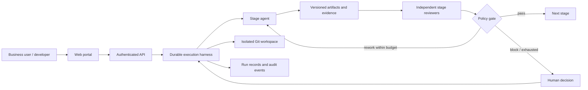

# MobileHeal product design

Status: proposed architecture for user review. Scope approved: local product, production deployment design, five-slide pitch deck. This document specifies intended behavior; it does not claim implementation or production certification.

## Product and audience

MobileHeal helps a team turn a requested mobile-app change or a reported failure into a reviewed, tested patch. People approve consequential decisions. The local product must run without external credentials, clearly identify simulated integrations, and preserve the existing isolated workspace.

Business users see what changed, why it matters, what remains uncertain, and who must act. Developers can inspect diffs, tests, reviewer findings and execution records. Architects can inspect contracts, policies, deployment boundaries and failure handling. Technical detail is progressively disclosed rather than placed in the main task flow.

## Existing baseline and gaps

The current FastAPI application provides delivery, crash healing, data-quality scans, Android/iOS agents, deterministic council opinions, code reviewers, and configurable human approval gates. Simulated services and parser mode support a local walkthrough. Existing security middleware includes origin checks, optional shared-token authentication and response headers.

The recorded full inherited suite was interrupted with 58 passed and 22 failed. Focused security, contract and watchdog tests passed. Council opinions can make claims beyond available evidence; affected-user estimates must be marked estimates or omitted. Optional authentication and configurable approval bypasses cannot constitute a production boundary. Native builds and live integrations remain unverified. These findings require investigation, not blanket deletion or weakening of tests.

## Architecture

The harness owns transitions; a model response cannot choose an arbitrary tool or bypass a gate. Reviewers receive the same frozen input and evidence. They do not read sibling verdicts before submitting their own findings. The join waits for every required reviewer; missing, failed, or timed-out reviews block advancement. This provides separate executions and roles, not proof of statistical independence between models.

### Delivery stages and reviewers

| Stage agent | Required reviewers | Evidence before advancement |
|---|---|---|
| Requirements interpreter | Product acceptance, ambiguity/contract | Versioned requirement, explicit assumptions, acceptance cases, human confirmation |
| Design proposer | UX/accessibility, acceptance coverage | Before/after proposal, field rules, contrast/layout checks, human design approval |
| Code implementer | Correctness, security/architecture | Commit-bound diff, allowed paths, tool results, regression results |
| Test planner/executor | Coverage, result integrity | Actual executed commands, exit codes, duration, artifacts, mapping to acceptance cases |
| Incident diagnostician | Root-cause evidence, safety | Captured failure, reproduction result, causal hypothesis, patch scope |
| Data-quality analyst | Rule correctness, privacy | Scan evidence, affected record counts, proposed corrective action; no unsolicited data mutation |
| Release coordinator | Gate consistency, operability | Current-commit reviews, passing required tests, human approval, rollback evidence |

Code reviewers remain platform-specific where appropriate. Deterministic reviewers operate in no-key mode; optional model reviewers must be visibly identified by provider/model and never masquerade as human approval.

## Harness contract

Every run stores run ID, request ID, stage, input revision, commit hash, policy version, agent/reviewer versions, mode, timestamps and idempotency key. States are queued, running, awaiting_review, awaiting_human, rework, passed, blocked, failed and cancelled. Transitions use persisted compare-and-set revision checks and a per-workspace execution lock. Restart marks interrupted tool work for reconciliation; it never silently duplicates a merge or remote write.

Tools have explicit names, input schemas, permissions, timeouts and output limits. Local default limits: two rework rounds per stage, one retry for a transient read, zero automatic retries for an unreconciled mutation, 120 seconds per reviewer and 300 seconds per tool execution. Native build adapters can specify longer bounded timeouts. Unknown tools, unsupported routing labels, malformed output, budget exhaustion and required evidence absence block the stage. Cancellation terminates subprocess trees and records the outcome. The product exposes a kill switch and a readable execution timeline.

Agent output: structured proposal, assumptions, evidence references and requested tool actions. Reviewer output: pass/rework/block, findings with severity and evidence, missing checks and score components. All outputs undergo schema validation. Rework returns to the responsible stage; a new artifact revision invalidates prior dependent reviews and approvals.

## Confidence and release decisions

Display an **evidence confidence score**, not a calibrated probability of correctness. Compute 0–100 from explicit, versioned components: acceptance coverage 30%, executed verification 30%, required review completeness 25%, reproducibility/provenance 15%. Unknown checks earn zero; skipped checks never count as passing. Show each numerator/denominator, source and timestamp. Thresholds are policy configuration and must be labeled policy choices, not empirical accuracy claims.

An initial advancement threshold of 85 requires every mandatory check to pass as well. A critical finding, failed required test, stale commit, absent review, unavailable required tool, unauthorized action or missing human release approval blocks regardless of score. A score cannot override a hard gate. Calibration against labeled outcomes is a future production requirement before probability language is used.

## Guardrails

- Workspace containment: resolve paths, reject traversal/symlink escapes, allow only approved source paths, and prohibit writes to credentials, launcher policy, Git internals and arbitrary host files.
- Tool execution: argument-vector invocation; no model-supplied shell command. Explicit executable and argument allowlists. Bound time, output, retries and process lifetime.
- Secrets and privacy: redact credentials and personal data before provider calls and logs. Synthetic local data by default. Audit references rather than raw customer payloads. External transmission requires configured destination and policy permission.
- Untrusted content: requirements, repository files, stack traces and tool output are data. Embedded instructions cannot change system policy or grant permissions.
- Approval identity: demo identities are labeled simulated. Production approval requires authenticated identity and role checks; authors cannot approve their own release. Approvals bind to the exact artifact revision/commit.
- External side effects: connectors disabled in local mode; enabled adapters declare destination, scope, idempotency/reconciliation behavior and audit receipts. Local merges are labeled local merges.
- Policy enforcement: secure defaults cannot be weakened by agents. Administrative policy changes are authenticated, audited and invalidate affected approvals. Production configuration fails closed when required identity or secrets are missing.
- Recovery: bounded rework, cancellation, interrupted-run reconciliation and tested rollback. No claim of instant or risk-free recovery without measured evidence.

## Local interface and documentation

Add an agent control-center view with stage status, assigned producer and reviewers, evidence confidence, policy blockers, execution timeline and next human action. Provide plain-language summaries and expandable technical evidence. Integrate these records into delivery/incident/data workflows rather than presenting an unrelated simulated dashboard.

Preserve separate `bash run-tutorial.sh` and `bash run-application.sh` launch instructions. Update tutorial screenshots and add editable architecture, sequence, parallel-review join and rework diagrams. Explain each implemented guardrail and score component with concrete examples.

## Production deployment design

Document a single-tenant initial deployment: TLS ingress, OIDC identity and role enforcement, API service, bounded worker processes in isolated containers, persistent database, separate artifact storage and managed secret injection. No public deployment is included in this scope. The local SQLite adapter remains available; production database support must be explicit, not implied.

Provide a threat model, configuration reference, backup/restore and rollback runbooks, audit retention rules, health/readiness semantics, and monitoring for queue age, gate failures, execution timeouts and recovery failures. Live provider/connector and native build validation remain conditional on configured services and SDKs. Security review, load tests and backup restoration are release requirements; the design alone is not evidence they passed.

## Acceptance criteria

1. A fresh local launch installs dependencies and serves a usable web application; tutorial launches separately.
2. A requirement completes proposal, design approval, code, independent review join, executed verification and authorized local merge with commit-bound evidence.
3. A reproduced crash enters diagnosis, review, approved patch and successful replay. Data scanning does not alter customer records without authorized action.
4. Tests demonstrate a blocked gate for each mandatory failure: critical finding, failed/absent tests, missing reviewer, stale evidence, low score, unauthorized tool/path, exhausted budget and missing human approval.
5. Restart, cancellation, retry and duplicate-request tests prove no duplicated mutation and no silent advancement.
6. Guardrail tests cover injection attempts, traversal/symlinks, secret redaction, malformed agent output and forbidden operations.
7. Scoring is deterministic, explained and versioned; missing evidence decreases confidence. Mandatory blockers dominate score.
8. Inherited failures are categorized and fixed when within product scope; environment-dependent checks are reported as unavailable, not passed. No broad production-ready claim with unresolved required failures.
9. Browser verification covers business/developer/architect views, clear status and next actions, desktop/mobile layout and keyboard operation.
10. Five editable pitch slides accurately distinguish working local capability, demonstrated evidence and production prerequisites.

## Five-slide pitch deck

1. MobileHeal: the customer problem, who uses it and a concrete profile-change example.
2. The product experience: request, review, evidence and human decision; explain value without unsupported metrics.
3. Agent workflow: sequence, parallel review join and pass/rework routing using the supplied visual reference's clear diagram approach.
4. Trust and control: evidence score, mandatory gates, bounded tools, audit and recovery; distinguish score from probability.
5. Deployment and adoption: local product, production architecture, pilot acceptance criteria and remaining integration validation.

White backgrounds, restrained teal/navy accents, editable diagrams and simple language. Speaker notes provide developer/architect detail and status disclosures. Deck claims must match the final verified implementation.

## Approved visual scope expansion

The user approved five intake sources: new change request, Firebase crash, issue email, internal Jira defect and BA requirements. All converge into intake/classification and the applicable delivery or recovery pipeline. The opening animated diagram supports source selection, start/pause/replay, rework routing, static mode and reduced motion. Animation of sample data is visibly distinct from live execution. Unconfigured connectors expose labeled mock examples rather than empty or misleading live status.

Refresh all existing application routes with one consistent navigation, breadcrumbs, spacing, typography, focus states and loading/empty/error/success treatment. Preserve existing capabilities and inspect home, requirements/new request/design/PR/tests, incidents, data health, monitor, crash sources/demo, App Studio, settings and audit. Rating 10/10 is an aspiration, not a measured guarantee. The LinkedIn reference could not be accessed; the user-provided earlier diagram establishes the visual direction.
